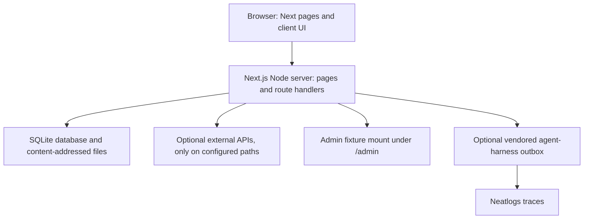

# Current architecture and integration state

**Observed repository snapshot:** `getticketstub.com` `main` at [`01c65ae2290447c523823bf4601d6373ce4c6ca2`](https://github.com/Jevelopers-neatHack-2026/getticketstub.com/tree/01c65ae2290447c523823bf4601d6373ce4c6ca2), observed 2026-10-12. This includes the host-owned landing implementation merged in PR [#104](https://github.com/Jevelopers-neatHack-2026/getticketstub.com/pull/104). Source behavior and integration comparisons below were audited at [`138e4b9019c0f5a55ad5e3f586d129216b680e4d`](https://github.com/Jevelopers-neatHack-2026/getticketstub.com/tree/138e4b9019c0f5a55ad5e3f586d129216b680e4d); the change through `01c65ae2290447c523823bf4601d6373ce4c6ca2` contains only the seven README updates in PR [#113](https://github.com/Jevelopers-neatHack-2026/getticketstub.com/pull/113), with no source, runtime or configuration changes. Cross-repository rows below name the independently observed `main` revisions used for comparison. They are source references, not dependency pins.

This is the maintained description of what the repositories contain and how they are connected **at those source revisions**. The immutable [architecture kit v1.0](../architecture-kit/v1.0/docs/architecture.md) remains the organization's dated **design intent**: one web app and worker, PostgreSQL, object storage, and the planned modules. This page does not replace that plan, establish a new target architecture, or record acceptance. Use the [master integration-evals checklist](https://github.com/Jevelopers-neatHack-2026/integration-evals/blob/main/planning/acceptance-checklist.md) for criterion state and evidence.

## Runtime present in getticketstub.com

The repository currently builds one Next.js App Router web application. src/app contains rendered pages and HTTP route handlers; src/server contains request validation, identity and authorization, storage, provider selection, and domain services. It has no separate general-purpose worker entry point, distributed job queue, PostgreSQL adapter, object-store adapter, or workspace assembling the other repositories. There is one narrower exception to a disconnected-source description: sanitized product events can be handed to a vendored, pinned agent-harness integration, which persists them in a local SQLite outbox and drains them in the background when explicitly enabled and configured. This is an optional telemetry/workflow-tracing path, not a general job system or proof of other integrations. This source-tree description makes no claim about services outside this repository.

The Node engine is `>=22.23.3 <23` and the package manager is npm `>=11.16.0 <12`; Next.js 16.4.0 and React 19.3.0 are pinned in `package.json` and the lockfile. The app uses `node:sqlite` in WAL mode. `TICKETSTUB_DB` selects the database path (default `./data/ticketstub.sqlite`); `TICKETSTUB_FILES` selects the artwork directory (default `./data/files`). Public deployments also need the exact HTTPS public origin in `APP_URL`; forwarded host headers do not establish authority. Startup probes write/read capability and `/api/health` reports storage and persistence mode. A default writable path can still be ephemeral across deployment. Durable data requires both configured paths to be on storage that survives deployment; the operator backup/restore procedure is in [the storage runbook](../operations/deployed-auth-storage-runbook.md).

The root page in this snapshot renders a host-owned landing experience from `src/customer/landing/` with `<StudioStart />` inserted after the hero (`src/app/page.tsx`). `landing.script.ts` says its page script was ported from `landing-page-repo/site/index.html`; the host carries its own component, script, markup and media rather than importing a package or serving the other repository's built artifact. This identifies the source relationship in code, not byte-for-byte lineage or owner acceptance. The hero intake routes to the app's `/new` flow, while the inserted studio-start section retains its local print-in-place intake. The separate repository's artifact still has no accepted host mount contract. `/admin/**` is guarded by the host and exposes the `ticketstub.admin-mount/1` types, but `src/app/admin/AdminMount.tsx` currently renders the host's `FixtureMount`; the `team-dashboard` package is not imported. The route inventory is in [routes.md](routes.md).

### Identity, persistence, and provider boundaries

The app derives actor, tenant, project, role and capabilities on the server from its httpOnly session/device cookies and persisted records. Browser-supplied role, tenant, project and context-summary values are not authority. The current signed-context implementation has versioned `/1` and `/2` shapes; `/2` separates deployment environment, economic mode and evidence mode, and the server can revalidate session and membership state. See [identity and context](identity.md) for exact claims, revocation, capability, and limitations.

SQLite-backed records cover accounts, sessions, walls, shares, orders, approvals, order authorizations, events, art usage, and operational records. Artwork bytes are stored as files addressed by content hash. This storage arrangement is single-host/local-file oriented; it is not the PostgreSQL/object-store topology in the v1.0 plan. See [private storage on Plus Launch](../operations/preview-runtime.md#private-storage-on-plus-launch) and the [deployed-storage and restore runbook](../operations/deployed-auth-storage-runbook.md).

Runtime mode, environment, economic mode and evidence mode are separate. `TICKETSTUB_RUNTIME_MODE=live` is the explicit switch for selected external research and AI provider paths; keys alone do not switch those paths on. A paid provider key in a non-live deploy is represented as `paid_test` rather than free/simulated. Demo research uses saved fixtures, artwork is simulated, and the current action-protocol agent returns deterministic rule-based proposals (`rules` provenance) without applying them; the legacy agent request path has separate fallback behavior. Resend email delivery is separately controlled and can still send when the app is in demo mode. Payment, production fulfillment, cost-ledger and product acceptance must be assessed against their own gates; the presence of a handler or an interface does not establish an accepted live integration. Detailed environment settings and deployment limitations remain in [preview runtime](../operations/preview-runtime.md).

## Cross-repository integration state

These are comparisons of source at pinned revisions. They describe what this app consumes at the snapshot above and distinguish local adapters and fixtures from a connected product integration.

| Repository and observed `main` | Current connection to this app | What that evidence does not establish |
|---|---|---|
| [`landing-page-repo` `dda1b5d48e71ed9c111b82111676b7ef033fe5ef`](https://github.com/Jevelopers-neatHack-2026/landing-page-repo/tree/dda1b5d48e71ed9c111b82111676b7ef033fe5ef) | Owns a standalone static HTML page and a deterministic local artifact builder. The host's app-native landing code identifies itself as ported from this repository, but the host does not import a package or serve the built artifact. | The source-port relationship is identified by a code comment, not a byte-identity or owner-acceptance receipt. The separate artifact mount, asset-path, CTA, script/style, rebuild/rollback contract, and actual host smoke remain unaccepted; see landing's [`integration/static-output.md`](https://github.com/Jevelopers-neatHack-2026/landing-page-repo/blob/dda1b5d48e71ed9c111b82111676b7ef033fe5ef/integration/static-output.md). |
| [`team-dashboard` `97e35e7f669f368b26c9884c48e7c181a26438b8`](https://github.com/Jevelopers-neatHack-2026/team-dashboard/tree/97e35e7f669f368b26c9884c48e7c181a26438b8) | The repository is public; its `package.json` sets `private: true`, so it is not npm-publishable through that manifest. It is a locally packable React library and fixture host. This app defines the host mount interface but imports its own fixture component. | A published or pinned package, host runtime/auth/data agreement, actual `/admin` package mount, and finance acceptance. Dashboard's `test:host` remains intentionally blocked pending the actual-host gate. |
| [`brand-kit` `6222a745195e9f15a14069e79210ad45daa16c94`](https://github.com/Jevelopers-neatHack-2026/brand-kit/tree/6222a745195e9f15a14069e79210ad45daa16c94) | The app serves local files under `public/brand` and has app-owned token/style files. The brand repository has source tokens, generated exports and logos; no versioned brand package is consumed. | This source comparison does not establish byte-for-byte copy lineage, brand ratification, rights clearance, consumer review or release eligibility. |
| [`shared-contracts` `91736a026c02a3206cb7666ebfbe6134692e5a24`](https://github.com/Jevelopers-neatHack-2026/shared-contracts/tree/91736a026c02a3206cb7666ebfbe6134692e5a24) | Some host-side shapes and fixtures are locally mirrored and checked by offline scripts. `package.json` has no shared-contracts dependency. | No package adoption, accepted producer/consumer conformance, or canonical cross-repository runtime contract. |
| [`event-intelligence` `ef69133bb38320793e02f8530accdd67e59f90e3`](https://github.com/Jevelopers-neatHack-2026/event-intelligence/tree/ef69133bb38320793e02f8530accdd67e59f90e3) | The app owns its `/api/research` flow and Ticketmaster adapter. It can form an `EventIntelligencePackage`-shaped response locally; there is no event-intelligence package import or runtime service call. | No event-intelligence service adoption, complete public research API acceptance, whole-site source traversal, or cross-repository acceptance. |
| [`creative-engine` `5b0f354dd8871550345863aef4017b7bbba3bd86`](https://github.com/Jevelopers-neatHack-2026/creative-engine/tree/5b0f354dd8871550345863aef4017b7bbba3bd86) | Host code owns a pure type/control adapter plus vendored fixture examples and an offline structural checker. The adapter performs no runtime I/O. | No creative-engine package/API call, provider operation through that repository, owner-accepted agreement or live creative workflow. |
| [`print-production` `89b5dd63c0a23dc27e62cfc235daa40dfe6d2002`](https://github.com/Jevelopers-neatHack-2026/print-production/tree/89b5dd63c0a23dc27e62cfc235daa40dfe6d2002) | Host commerce code describes its own preview capabilities and local order flow. It does not import print-production or consume a generated `ProductionBundle`. | No accepted product/SKU, production bundle, print validation or live print workflow. |
| [`fulfillment-connectors` `a1c04e6424626475c7c6db3d397cc6e3392c1600`](https://github.com/Jevelopers-neatHack-2026/fulfillment-connectors/tree/a1c04e6424626475c7c6db3d397cc6e3392c1600) | Host code has its own order-authorization issuer and signed consumer endpoints, with local fixture checks. No fulfillment-connectors package is imported or called by the application at runtime. | No app-to-adapter connection, accepted authorization mapping, real supplier submission or shipment. Consumer work in the connector repository does not by itself mean this app is integrated. |
| [`cost-intelligence` `50910da5999fc099558ecf07c075488fd4cfd1be`](https://github.com/Jevelopers-neatHack-2026/cost-intelligence/tree/50910da5999fc099558ecf07c075488fd4cfd1be) | The app has a local finance/admin view and usage records; it has no cost-intelligence dependency, API client or vendored module. | No authoritative finance ledger, finance budget handshake, reconciled reports or dashboard finance source. |
| [`agent-harness` main `fce81e4f31f4047827d7de69a4e2da35415bc4c8`](https://github.com/Jevelopers-neatHack-2026/agent-harness/tree/fce81e4f31f4047827d7de69a4e2da35415bc4c8) | `src/server/harness-export.ts` imports the vendored snapshot pinned to agent-harness commit `340f5abff0837c8fb8f7c9a5454aee58ee2071fb` in `src/server/vendor/agent-harness/MANIFEST.json`. The exporter is off unless `TICKETSTUB_HARNESS_EXPORT=neatlogs`; it also requires `AGENT_HARNESS_TELEMETRY_KEY`, `NEATLOGS_INGEST_KEY` (or the source-supported legacy ingest name), and a durable path from `TICKETSTUB_HARNESS_DB` or `TICKETSTUB_DB`. The vendored integration validates and tokenizes `ticketstub.event/1` records, writes them to a SQLite outbox, then drains in the background. Without an explicit outbox path it derives `agent-harness-outbox.sqlite` beside `TICKETSTUB_DB`. Optional trace readback requires separate read credentials. `GET /api/admin/harness` reports scoped status; `POST` performs a drain/readback pass. | This is a real, opt-in product-event telemetry connection with durable local queuing and background delivery. It does not prove that a particular deployment enabled or configured it, or that every trace reached or was retained by Neatlogs. The app vendors commit `340f5ab...` rather than consuming current agent-harness main at `fce81e4...`; this source comparison is not a current-version adoption claim. It is not a general job worker. The separate operational `ticketstub.ops/1` exporter is documented in [observability](../operations/observability.md); its owner-accepted evidence is scoped below. Product-event isolation and failure handling are in [events](events.md). |
| [`marketing-material` `79ae21607eb4d98188f85ce3c42b8be6eb5688bc`](https://github.com/Jevelopers-neatHack-2026/marketing-material/tree/79ae21607eb4d98188f85ce3c42b8be6eb5688bc) | Maintained collateral and evidence references remain in that repository; no runtime import exists here. | No product claim, asset permission, submission readiness or launch approval is inferred. |
| [Public submission/evidence repository `9580b9b3eebd90470c8c322d95ee169f153995d3`](https://github.com/Jevelopers-neatHack-2026/Jevelopers-GetTicketStub.com-Submission/tree/9580b9b3eebd90470c8c322d95ee169f153995d3) | Collects a judge guide, five maintained judge documents, generated repository/source indexes, and copied component snapshots. Its sync records identify the snapshots as generated evidence and direct implementation changes to the owning component repositories. | It is not a product runtime, package dependency, source of component code, or integration-acceptance authority. Treat copied trees as dated evidence, not editable upstream code. |

The private `entire-checkpoints` repository has no auditable source at the inspected authorized metadata boundary: no visible branch, commit or tree refs, and therefore no source SHA or implementation content to compare. Its destination or product role cannot be confirmed from that empty metadata. The integration manifest is currently absent. [`integration/repository-map.json`](../../integration/repository-map.json) labels itself a `planning_inventory`, says `is_dependency_lockfile: false`, and marks the repository implementation rows unverified. Do not use it as a source pin or release bill of materials. The separate [assembly evidence validator](../integration/assembly-evidence.md) checks declared inventory and execution claims for a candidate, but a self-consistent local receipt is not acceptance. The authoritative cross-repository criteria and evidence remain in [integration-evals main `56018576a9450a2bb46aa55ed3b2f9d9ae97e50d`](https://github.com/Jevelopers-neatHack-2026/integration-evals/tree/56018576a9450a2bb46aa55ed3b2f9d9ae97e50d).

### Separately accepted Neatlogs evidence

The master checklist at integration-evals `56018576a9450a2bb46aa55ed3b2f9d9ae97e50d` records **SPN-01 Neatlogs use as owner-accepted on 2026-10-11**. Its evidence is the dated [Neatlogs record](https://github.com/Jevelopers-neatHack-2026/integration-evals/tree/56018576a9450a2bb46aa55ed3b2f9d9ae97e50d/evidence/neatlogs/2026-10-11) and the qualified [record summary](https://github.com/Jevelopers-neatHack-2026/integration-evals/blob/56018576a9450a2bb46aa55ed3b2f9d9ae97e50d/evidence/neatlogs/2026-10-11/README.md). That acceptance applies to the specifically reported `ticketstub.ops/1` operational-trace run and the limitations documented there. It is distinct from the vendored `ticketstub.event/1` durable product-event outbox described above; it does not establish that the outbox is enabled in a deployment, complete Neatlogs delivery, cost reconciliation, or acceptance of the whole application. The master record also notes missing raw host/backend receipts and that three of seven sessions were not found in the reported original readback window. Follow the master checklist and its linked record for criterion status and the full qualification.

## How to read status and evidence

- **Source exists** means a file, route, package, adapter or test is present at the cited SHA.
- **Fixture-tested** means the specific local synthetic/offline path is covered by the named check. It does not mean an external provider, supplier or repository was used.
- **Host or deployment observed** means only the dated, scoped receipt linked by its owning document. It does not identify an unreported source revision.
- **Owner accepted / release accepted** is not declared here. Check the controlling issue comment and the master acceptance tracker.

For local build and route checks use [development documentation in the root README](../../README.md#checks) and [the runtime workflow](../../.github/workflows/runtime.yml). API method, auth, payload and response boundaries are catalogued in [HTTP API reference](../api/HTTP-API.md). Security behavior and known gaps are in [identity](identity.md), [boundaries](boundaries.md), [approval](approval.md) and [order authorization](order-authorization.md). Operational state and third-party evidence remain in the dated [operations records](../operations/).

This page is an observation of the source pins above. Refresh those pins and the relevant rows after a main change; do not edit the checksummed v1.0 snapshot to make it look like current implementation evidence.
