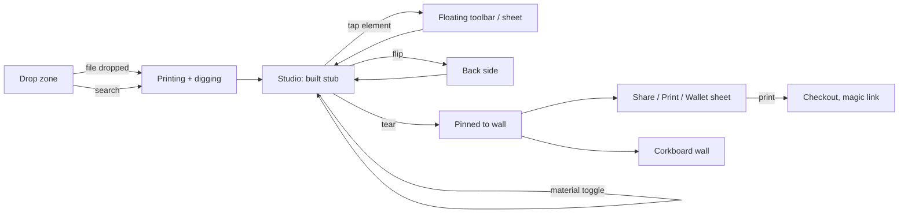

# Flow

Mobile-first, screen by screen. Copy follows the brand-kit voice: say what they get, then what to do. Theme: **D** = day (paper desk), **N** = night (stage).

## 1. Drop zone (D)

- **Layout:** a blank stub-shaped drop area on the desk. Previously made stubs peek in from the bottom edge.
- **Copy:** "Turn your ticket into a stub worth keeping." Button: "Choose a screenshot". Secondary pill: "Search for your show".
- **Inputs:** drop a file, paste, use the share sheet from another app, or forward an email (async: the stub appears on the wall later).
- **Fields:** none. Search is the only text input, and it autocompletes.

## 2. Printing and digging (N)

- **Layout:** the stub feeds out of a printer slot at the top. The foil sweep loops (2.6 s) and the thermal-printer whirr plays.
- **Research facts:** fact cards drift past as the research sub-agent returns them: "Night 2 of 3", "7°C, light rain", "Opener: Velvet Coast". Each card is reused as a constraint on the art.
- **Completion:** the 320 ms shutter flash, a paper-snap sound, and haptic `[18, 40, 28]`.
- **Target:** under 8 s to the first stub. If the art isn't ready, show the edition with a placeholder texture and swap the art in when it lands.

## 3. Studio (D)

The stub sits centred on the desk. The top bar holds the stamp, an event crumb and the mute toggle.

| Gesture | Result |
|---|---|
| Tap an element | Selects it and shows the floating toolbar beside it (font, colour, foil, remove) |
| Long-press an element | Bottom sheet with deeper options |
| Swipe on the stub's background or edge | Deals the next style with the same data; a history strip lets you go back |
| Long-press the background | Grid of style variants |
| Pulsing chip | "Is this the date? Tap to fix." Opens 2–3 guesses as chips |
| Ghost "+" chip | Adds a known-but-hidden field (seat, opener, weather) |
| "Remix" | Vibe chips; free text hidden behind "more" |
| Flip control, or swipe up on the stub | 3D flip to the back side |
| Tilt (gyro) or hover | Foil and glare follow the light |

- **Material toggle:** a fixed pill reading **Digital $9 · Card $29 · Print $49 · Framed $89**. Each option re-renders the stub on that stock (card grain, print border, a frame with a mat), and the CTA changes to match: "Print it for $49".
- **Matching stubs:** "Send a matching stub to the people you went with" creates a claim link, or builds the whole set at once.

## 4. Back side (D)

Laid out as a stub card: a setlist from Setlist.fm with a tap-to-star favorite, a handwritten-style note (optional free text, the second of the two text fields), friend avatars linked to their stubs, a QR code to the memory page, and the Ts stamp.

## 5. Tear and pin (N, then D)

- **Prompt:** "Tear to finish".
- **Tearing:** drag along the perforation. The stub follows with resistance, the tearing sound tracks drag speed, and each hole crossed ticks the haptic `[4]`. Past 60% it rips free.
- **Pinning:** the stub flies to the corkboard, rotates to a random angle between -4° and 4°, and pins with a thunk and haptic `[20]`.
- **Afterwards:** a sheet offers Share your stub / Print it / Add to Wallet.

## 6. Checkout and save

- **Account:** "Save to your wall. We'll email you a link." The magic link is the only account step.
- **Checkout:** the material and finish are already chosen on the stub, so checkout only asks for shipping and payment, using the platform pay sheet where available.

## 7. Corkboard wall (D)

Stubs pinned at angles. Drag to rearrange, tap to open. There's a "Make it public" toggle for the shareable page.

## Organizer mode (desktop-first)

1. **Design:** the organizer designs in the same studio and locks brand elements (shown with lock icons).
2. **Data:** drop a CSV or guest list, then bind name and seat chips to its columns. A per-attendee preview pages through the list ("Seat A12 — Priya, 1 / 240").
3. **Publish**, either way:
   - **Merge** prints everyone's stub.
   - **Claim link** lets each attendee personalize their stub within the locks.
